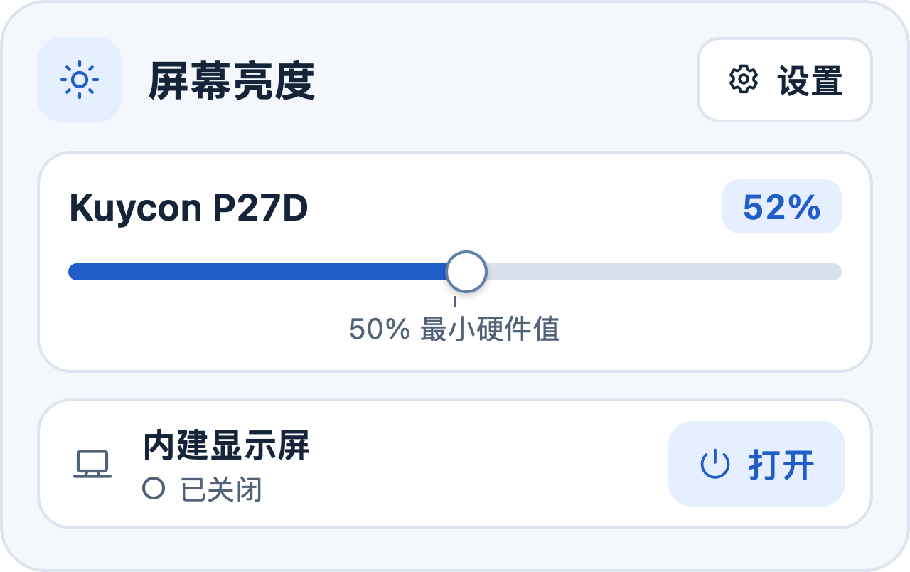

# 屏 · Ping Display

在 Apple Silicon Mac 的菜单栏里调节内建屏和外接屏的亮度，或在双屏与外接独占之间切换。屏是独立的 macOS 应用，无需安装 Hammerspoon 或 BetterDisplay。



[从源码构建](#从源码构建) · [版本记录](CHANGELOG.md) · [问题反馈](https://github.com/NigelQYN/ping-display/issues/new/choose)

## 能做什么

- **分别调节两块屏幕**。内建屏用 macOS 背光控制，兼容的外接屏通过 DDC/CI 调硬件背光。背光降至最低后，可用软调暗继续降低画面亮度。外接屏滑条上的 50% 刻度表示硬件背光的最低档。
- **开关内建屏**。接上外接屏时，可以手动关闭内建屏，也可以让应用自动切换。自动模式下，外接屏断开后会尝试恢复内建屏。
- **从菜单栏快速操作**。点太阳图标打开亮度面板，从齿轮菜单配置登录时启动、亮度键和环境光调节。也可在访达直接打开应用窗口。
- **接入脚本和光感硬件**。自带命令行工具。可选的 USB 光感功能接受以 115200 波特率发送、用换行分隔的 `LUX:<数值>`，仅自动调节唯一一块活动外接屏。

## 系统要求与实测范围

- **Mac** 使用 Apple Silicon，应用的构建目标为 macOS 13 或更新版本。
- **外接屏**及连接方式需支持 DDC/CI。若显示器菜单有 DDC/CI 开关，请先开启。
- **实测环境**为 macOS 27.2、Apple M4 和 Kuycon P27D。验证了启动、内建屏开关、两类屏幕的背光及软调暗、组合亮度命令。USB 光感板、亮度键授权及登录时启动仍待端到端验证。
- **兼容性**取决于机型、系统和连接方式。硬件控制使用 macOS 私有接口。内建屏曲线包含开发机的目视校准，不同设备的同一百分比可能观感不同。

## 从源码构建

当前公开版本提供源码。构建脚本生成适合本机试用的签名版本，面向其他 Mac 分发的 Developer ID 签名与公证版尚未发布。 [Apple 分发说明](https://developer.apple.com/macos/distribution)

在 Apple Silicon Mac 上安装 Xcode Command Line Tools，然后在终端执行下面的命令。

```sh
git clone https://github.com/NigelQYN/ping-display.git
cd ping-display
./build.sh
open "build/屏.app"
```

应用也可以从访达双击打开。关闭窗口后，应用会留在菜单栏。使用 Thaw 等菜单栏整理工具时，可以在其隐藏区域查找太阳图标。

如果已有其他工具接管显示器，请先暂停它的调光和亮度键控制。启用光感时，先停止占用同一个串口的程序，再在齿轮菜单设置设备路径。软调暗需要恢复时，选择「取消软调暗」，也可在快捷键可用时按 `⌃⌥⌘B`。

## 命令行

```sh
helper="./build/屏.app/Contents/MacOS/displayctl"
"$helper" list
"$helper" cli set -brightness=70%
"$helper" cli set -brightness=45% -name="Kuycon P27D"
"$helper" builtin on
```

`list` 和 `builtin on|off` 可以独立运行。组合亮度命令需要先打开屏。默认目标是唯一活动的外接屏，也可用 `-UUID=...`、`-displayID=...` 或 `-name=...` 指定显示器。旧光感脚本可将工具路径改为应用包中的 `displayctl`。

`list` 可能返回显示器 UUID 或序列号，公开反馈前请先删去这些字段。

## 反馈与贡献

遇到问题时，可以[提交 Issue](https://github.com/NigelQYN/ping-display/issues/new/choose)。请附上 Mac 芯片、macOS 版本、显示器型号和连接方式。欢迎补充兼容性结果和提交改动，详见[贡献说明](CONTRIBUTING.md)。

## 许可证

本项目采用 [MIT 许可证](LICENSE)，由 [NigelQYN](https://github.com/NigelQYN) 维护。
